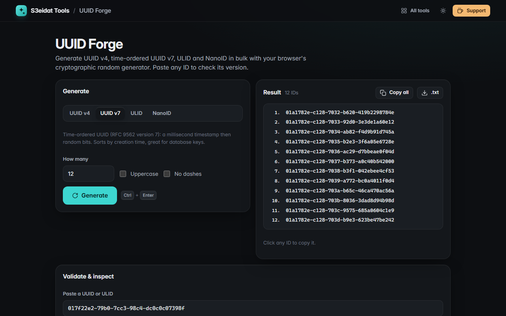

# UUID Forge

> Generate UUID v4, UUID v7, ULID and NanoID in bulk, and inspect any UUID. Free, private, and it runs entirely in your browser.

### ▶ [Open UUID Forge](https://s3eidat.github.io/uuid-forge/)



## Features

- **UUID v4** (random, via `crypto.randomUUID`)
- **UUID v7** (RFC 9562, time-ordered) with a per-millisecond counter, so a bulk batch is strictly sorted
- **ULID** (Crockford Base32, monotonic within the same millisecond)
- **NanoID** with custom length and alphabet (URL-safe, alphanumeric, hex, numbers, no look-alikes, or your own),
  unbiased rejection sampling and a live "bits of randomness" read-out
- Generate **1 to 1000** at once, uppercase or without dashes; click any ID to copy it, copy all, or download `.txt`
- **Validator**: paste a UUID (dashes, braces or `urn:uuid:` are fine) or a ULID to see its version, variant and,
  for v1/v6/v7 and ULID, the creation time

All randomness comes from the browser's cryptographically secure generator (`crypto.getRandomValues`).

## Privacy

Nothing is sent anywhere. There is no server, no account, no analytics.
The page ships with a strict Content-Security-Policy (`connect-src 'self'`), so the browser
itself blocks any attempt to send data anywhere.

## Run it yourself

It's plain HTML, CSS and JavaScript with no build step:

```bash
git clone https://github.com/s3eidat/uuid-forge
cd uuid-forge
python -m http.server 8000
```

Then open http://localhost:8000.

## Support

If this saved you time, **[buy me a coffee ☕](https://s3eidat.github.io/coffee/)**. It keeps every tool free.

---

Part of **[S3eidat Tools](https://s3eidat.github.io/)**: 100+ free, private tools that run in your browser. MIT licensed.
